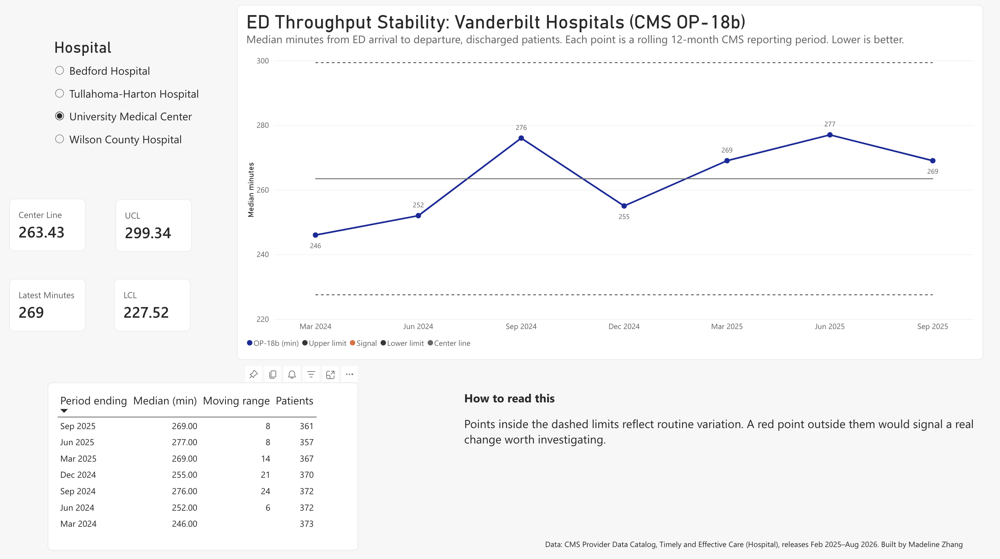

# ED Throughput Stability: Vanderbilt Hospitals (CMS OP-18b)

An interactive Power BI XmR control chart showing whether emergency department throughput at four Vanderbilt hospitals is stable or changing. The data is public CMS Hospital Compare data covering seven quarterly reporting periods (12-month windows ending Mar 2024 through Sep 2025).



## The question

**OP-18b** is the median time, in minutes, from emergency department arrival to departure for patients who are discharged home. Lower is better. When the number moves from one release to the next, is that a real change or ordinary noise?

A **control chart** answers that question. Each period's value is plotted against a center line (the hospital's average) and upper and lower control limits set at about ±3 sigma. A point inside the limits reflects routine, common-cause variation. A point outside them is a special-cause signal worth investigating.

## Findings

All four hospitals stayed inside their control limits in every period, so there is no statistical evidence of a real shift in ED throughput over this window.

| Hospital | Center line (min) | Control limits (min) | Latest (Sep 2025) |
| --- | --- | --- | --- |
| University Medical Center | 263.4 | 227.5 – 299.3 | 269 |
| Wilson County Hospital | 174.1 | 160.4 – 187.9 | 162 |
| Tullahoma-Harton Hospital | 172.3 | 157.2 – 187.4 | 168 |
| Bedford Hospital | 125.6 | 118.5 – 132.7 | 125 |

University Medical Center, the academic medical center, runs 90–140 minutes longer than the community hospitals and varies 2.4–5× as much from period to period.

## How it's built

1. **Data:** CMS Provider Data Catalog, Timely and Effective Care – Hospital dataset. It was pulled into Databricks in an earlier pipeline project, then filtered to OP-18b and cleaned with pandas (`data/op18b_clean.csv`).
2. **Model:** a single-table semantic model in the Power BI service. It was built entirely in the browser.
3. **DAX:** three calculated columns build the moving range (`RANKX` + `EARLIER` for period order, a `MAXX` lookup for the previous value). Measures use `CALCULATE` + `ALLEXCEPT` to compute per-hospital limits that ignore the chart's period filter but respect the hospital slicer. See [`measures.md`](measures.md).
4. **Visual:** a five-series line chart (value, center line, UCL, LCL, signal markers), a single-select hospital slicer, KPI cards, and a detail table.

XmR control limits:

```
UCL, LCL = X̄ ± 2.66 × mR̄
```

where mR̄ is the average absolute change between consecutive periods, and 2.66 = 3 / 1.128.

## Limitations

- **Overlapping windows.** CMS publishes rolling 12-month medians, so consecutive points share 9 of their 12 months. That smooths the series and shrinks the moving ranges, which makes the limits tighter than they would be on independent data.
- **Seven points.** SPC practice prefers 20 or more points before treating limits as stable, so these limits are provisional.
- **Summary statistic.** Each point is a facility-level median, not individual patient visits.

## Files

| File | What it is |
| --- | --- |
| `ED_Throughput_Stability.pbix` | The Power BI report. Opens in Power BI Desktop (Windows) or uploads to any Power BI workspace |
| `ED_Throughput_Stability.pdf` | Static export of the report page |
| `data/op18b_clean.csv` | Cleaned dataset: 28 rows, 4 hospitals × 7 periods |
| `measures.md` | Every DAX column and measure, with explanations |

## Next steps

- Append each new quarterly CMS release and watch for signals.
- Add the Tennessee state average as a reference line.
- Apply Western Electric run rules (for example, 8 points in a row on one side of the center line).

---

Built by Madeline Zhang · Data: [CMS Provider Data Catalog](https://data.cms.gov/provider-data/), releases Feb 2025 – Aug 2026
